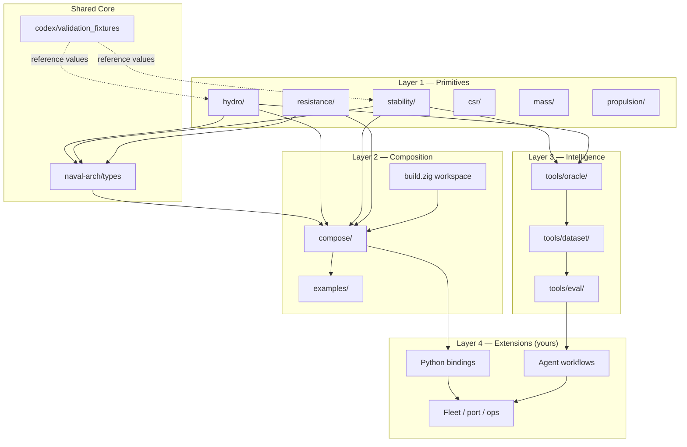
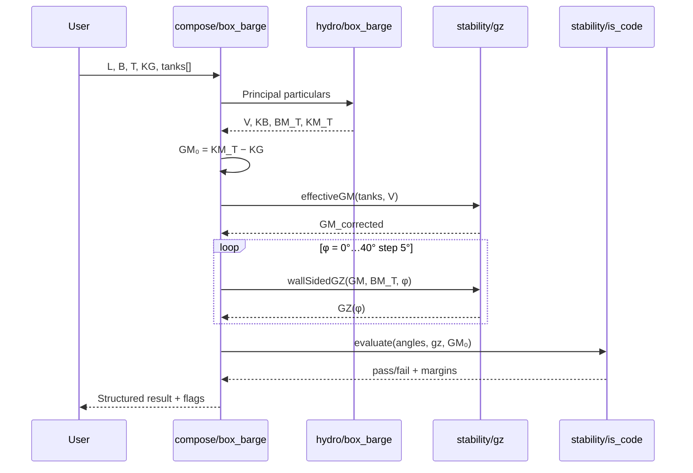
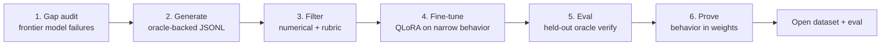

# Yard Platform — Naval Excel for Verifiable Marine Engineering

**Version:** 0.1.0-platform-alpha  
**Date:** 2026-07-07  
**License:** Apache-2.0 (unified across all modules)

---

## The Thesis

Microsoft made Excel. Goldman Sachs made more money *on* Excel than Microsoft made *from* Excel — because the value is in the integrations, workflows, and domain layers bolted on top of a reliable substrate.

**Yard is the substrate.** Sixty-nine Zig primitives, each narrow, tested, and oracle-backed. The platform layer is what turns primitives into a system that operators, researchers, and power users can extend orders of magnitude beyond what any single author could build.

```
┌─────────────────────────────────────────────────────────────────────────┐
│  LAYER 4: Operator Extensions (your Goldman layer)                      │
│  Custom workflows · Fleet dashboards · Class-society reports · Agents   │
├─────────────────────────────────────────────────────────────────────────┤
│  LAYER 3: Intelligence (dataset + fine-tuned models + eval harness)    │
│  yard-stability-oracle · SFT datasets · domain eval · agent tooling     │
├─────────────────────────────────────────────────────────────────────────┤
│  LAYER 2: Composition (compose/ + examples/ + CLI bindings)           │
│  Multi-module workflows · shared types · JSON I/O · Python FFI           │
├─────────────────────────────────────────────────────────────────────────┤
│  LAYER 1: Primitives (69 modules — hydro, stability, resistance, …)   │
│  Unit-tested · analytically validated · explicit validity envelopes     │
└─────────────────────────────────────────────────────────────────────────┘
```

The **dataset is the deliverable.** The Zig oracle is ground truth. The fine-tuned model internalizes behaviors frontier LLMs miss. Everything else is scaffolding that makes the substrate composable.

---

## Architecture



---

## Proof Levels

Every module and workflow declares an explicit proof level. Do not overclaim.

| Level | Meaning | Example |
|-------|---------|---------|
| `unit-tested` | Analytical / closed-form agreement within tolerance | Wigley C_B = 4/9 |
| `cross-validated` | Agreement with independent OSS implementation | Holtrop vs FreeCAD-Ship |
| `benchmark-hull` | Agreement with standard hull (Series 60, KCS, …) | *planned* |
| `model-test` | Agreement with towing-tank data | *planned* |
| `class-society` | Reviewed against rulebook + expert sign-off | *not claimed* |

Current platform state: **unit-tested** and **cross-validated** on core primitives. Composition workflows inherit the weakest link in their chain.

---

## Core Workflow: Box-Barge Intact Stability

The canonical end-to-end example wires `hydro` → `stability` → IMO IS Code 2008 Part A 2.2.



### Run it

```sh
cd examples/box-barge-intact-stability
zig build run
zig build test
```

From workspace root:

```sh
zig build test-core      # hydro + stability + compose + example
zig build run-example    # canonical box-barge case
```

---

## Intelligence Stack: Dataset → Fine-tune → Eval

Frontier models are ~80% good at naval architecture. They fail on:

- Free-surface correction (missed or wrong formula)
- Wall-sided vs small-angle GZ confusion
- IMO IS Code threshold application
- Validity envelope violations answered with confidence
- Subtle constant errors (ρ, g, permeability)

**The gap is measurable.** The Zig code is the oracle.



### Quick start

```sh
# Generate 100-sample seed dataset (oracle-verified)
python tools/dataset/generate.py --samples 100 --output tools/dataset/out/seed.jsonl

# Run eval harness against oracle (baseline before fine-tune)
python tools/eval/harness.py --dataset tools/dataset/out/seed.jsonl --mode oracle
```

See [docs/03-dataset-finetune.md](docs/03-dataset-finetune.md) for the full 6-step execution plan.

---

## Module Taxonomy

| Tier | Modules | Role |
|------|---------|------|
| **Core** | hydro, stability, resistance, mass, propulsion, csr, naval-arch | Composable design loop |
| **Structures** | strength, csr-buckling, csr-fatigue, deck, shaft, springing | Hull girder + local strength |
| **Seakeeping** | seakeeping, bem, strip-theory, coupled-motions, rao-spectrum | Motions + loads |
| **Operations** | port-logistics, terminal, mooring, routing, dynpos | Fleet + port |
| **Regulatory** | cii, eedi, load-line, stir, recycling | Compliance overlays |
| **Experimental** | combat, shipyard-mgmt, saildrone, … | Clearly labeled; not core path |

**Rule:** No new modules until core 6–8 are composable with published examples and benchmark-hull validation.

---

## Extension Points (Build Your Goldman Layer)

| Extension | Interface | What you get |
|-----------|-----------|--------------|
| **Zig compose workflows** | `compose/` module imports | Type-safe multi-primitive pipelines |
| **Python oracle** | `tools/oracle/` | Fast dataset generation, external tool parity |
| **JSON schema** | `tools/dataset/schema.json` | Structured I/O for agents and UIs |
| **Eval harness** | `tools/eval/harness.py` | Regression gate for models and prompts |
| **FFI / CLI** | *planned* `yard-cli` | Non-Zig consumers |
| **FMI co-simulation** | `fmi/` module | CFD/MBD coupling |

---

## Validation Roadmap

1. **Now:** Analytical fixtures (Wigley, box-barge) — `unit-tested`
2. **Next:** Wigley + Series 60 resistance comparison — `cross-validated` → `benchmark-hull`
3. **Then:** KCS/KVLCC2 seakeeping RAOs — `benchmark-hull`
4. **Later:** Towing-tank correlation — `model-test`
5. **Never without experts:** Class-society sign-off — `class-society`

Published benchmark comparisons live in `docs/validation/` as they land.

---

## Directory Map

```
yard/
├── PLATFORM.md              ← you are here
├── build.zig                ← workspace: test-core, run-example, test-all
├── naval-arch/              ← shared types, units, physical constants
├── compose/                 ← multi-module workflows
├── examples/
│   └── box-barge-intact-stability/
├── tools/
│   ├── oracle/              ← Python reference implementation (ground truth)
│   ├── dataset/             ← SFT data generation pipeline
│   └── eval/                ← custom eval harness
├── docs/
│   ├── 01-architecture.md
│   ├── 02-stability-workflow.md
│   └── 03-dataset-finetune.md
└── [69 primitive modules]/
```

---

## Ruthless Truths (from audit, retained)

- 69 modules ≠ 69 production systems. Most are narrow slices.
- No class-society grade V&V yet. Use with independent verification.
- Zig 0.16 pinning is technical debt until 1.0.
- The value is composition + dataset + your extensions — not module count.

---

## Next Concrete Steps

1. Run `zig build test-core` — confirm composition chain is green.
2. Generate seed dataset: `python tools/dataset/generate.py --samples 500`.
3. Gap-audit frontier models on held-out eval cases.
4. Fine-tune Phi-4 / Qwen3.5-7B with Unsloth QLoRA.
5. Publish dataset + eval + ablation results.

**The substrate is built. The platform is composable. The dataset is the moat. Build your layer.**