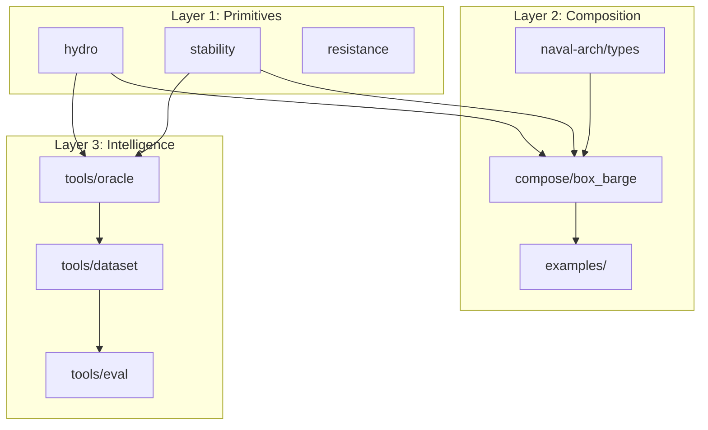

# Architecture Deep Dive

## Design Principles

1. **One thing well** — Each of 69 modules implements a single verifiable primitive.
2. **Explicit proof levels** — Never overclaim validation depth.
3. **Oracle-first** — Zig code is ground truth; Python oracle mirrors for dataset scale.
4. **Composition over god-modules** — `compose/` wires primitives; operators extend upward.

## Layer Interaction



## Shared Type Contract

`naval-arch/src/types.zig` defines the interchange schema:

| Type | Used by | Purpose |
|------|---------|---------|
| `PrincipalParticulars` | All hull workflows | L, B, T |
| `LoadingCondition` | Stability workflows | KG + tanks |
| `Hydrostatics` | Hydro → compose | V, KB, BM, KM |
| `StabilitySummary` | Stability → compose | GM, GG', flags |
| `IsCodeResult` | Regulatory overlay | Six criteria + overall |
| `ValidityFlags` | All workflows | Assumption tracking |

Primitive modules do **not** import `naval-arch`. Only `compose/` and `examples/` do.
This preserves independent adoption of any single primitive.

## Extension Pattern (Goldman Layer)


Recommended extension path:

1. Fork or add `compose/src/your_workflow.zig`
2. Import only the primitives you need
3. Emit structured output matching `tools/dataset/schema.json`
4. Add eval cases to `tools/eval/`
5. Publish your layer; yard substrate stays stable

## CI Topology

```
push → test-core (hydro, stability, naval-arch, compose, example)
     → test-all  (69 modules, parallel matrix)
     → oracle self-test
     → dataset integrity check
```

See `.github/workflows/ci.yml`.